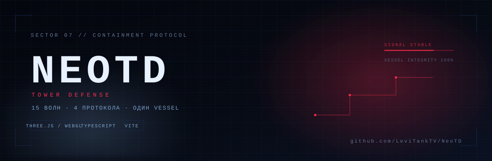
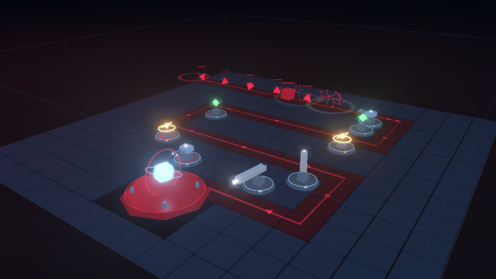
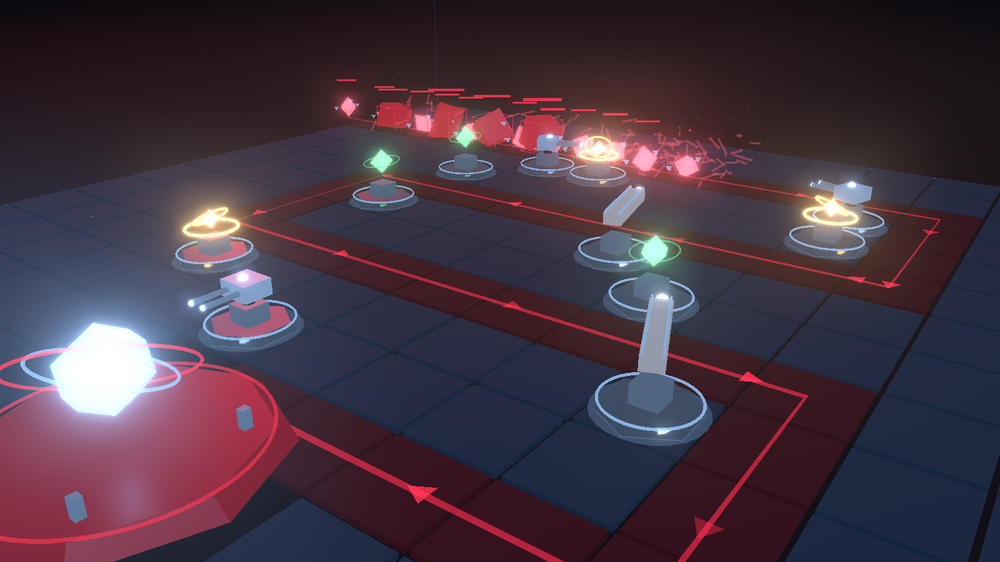

<p align="center">
  
</p>

<p align="center">
  <a href="https://github.com/LeviTankTV/NeoTD/stargazers"></a>
  
  
  
  
  
</p>

<h3 align="center">3D tower defense в терминальной эстетике</h3>

<p align="center">
  Чёрная пустота. Сетка сдерживания. По маршруту идут фрагменты — их цель ядро <b>VESSEL</b>.<br />
  Ты оператор сектора: четыре протокола, восемь типов угроз, пять арен и профиль с двадцатью четырьмя достижениями.
</p>

<p align="center">
  <a href="#запуск"><b>Запустить локально</b></a> ·
  <a href="docs/RESEARCH.md"><b>Исследование рынка TD</b></a> ·
  <a href="docs/PLAN.md"><b>План развития</b></a> ·
  <a href="docs/BALANCE.md"><b>Отчёт баланса</b></a>
</p>

---

## Скриншоты

<p align="center">
  
  
</p>

<p align="center"><sub>Слева — оборона ранних волн. Справа — контакт с GATE и GLITCH.</sub></p>

---

## Что внутри

- **Настоящий 3D.** Арена, маршруты, башни, враги и ядро строятся кодом на Three.js — ни одного внешнего ассета. Bloom, пыль, обломки, сигнальные пилоны, следы выстрелов и тряска камеры.
- **Пять арен.** SECTOR 07, CROSSFIRE, THE WELL, TWIN GATE и SPLIT SIGNAL. Две последние дают два входа и два маршрута к одному ядру — оборону приходится делить.
- **Ветки апгрейдов.** На третьем уровне башня выбирает специализацию: темп, бронебой, радиус, замедление или кислоту.
- **Восемь типов угроз.** Рой, глитчи, броня, щиты с регенерацией, летающие в обход маршрута, делящиеся, невидимые и два босса.
- **Три режима.** Кампания из 15 волн, бесконечный протокол и ROGUE с модификаторами волн и выбором наград.
- **Три сложности.** От спокойной с запасом DATA до хардкора с урезанным бюджетом.
- **Профиль оператора.** Автосохранение в браузере: рекорды по каждой арене и сложности, 24 достижения в четырёх категориях, статистика и титулы.
- **Косметика без обязательного гринда.** За достижения открываются титулы и палитры HUD — они не влияют на силу.
- **ROGUE на 17 модификаторов и 21 модуль.** Награда раз в две волны, а каждый взятый модуль поднимает давление врагов — усиления не бесплатны.
- **Два языка.** Русский и английский интерфейс, переключатель на титульном экране, выбор запоминается.
- **Туториал.** Пять шагов на первой волне: поставить башню, улучшить, настроить приоритет, запустить волну, удержать сигнал. Пропускается и больше не возвращается.
- **Операторский интерфейс.** Терминальные рамки, моноширинная типографика, сканлайны, глитч-переходы, сигнальные анимации при прорыве и отдельная подача боссов.
- **Симулятор баланса.** `npm run balance` играет 2250 забегов пятью стратегиями и собирает [отчёт](docs/BALANCE.md).
- **Desktop-сборка.** Electron-обёртка, portable `.exe` для Windows и AppImage для Linux.

---

## Управление

| Клавиша | Действие |
| --- | --- |
| `1` – `4` | выбрать протокол: SENTRY / PULSE / SNARE / RAIL |
| ЛКМ по клетке | поставить башню |
| ЛКМ по башне | выбрать, открыть панель |
| `U` | улучшить выбранную башню |
| `S` | продать (возврат 65%) |
| `G` | переместить выбранную башню |
| `Ctrl+Z` | отменить последнее действие |
| `V` | вид сверху / орбита |
| `Space` | запустить волну |
| Перетаскивание | вращение камеры |
| Колесо | зум |
| `Esc` | снять выбор |
| `M` | звук |

Прогресс, рекорды и достижения лежат в `localStorage` браузера (в desktop-версии — в профиле приложения). Кнопка **АРХИВ** на титульном экране открывает достижения, рекорды, титулы и статистику.

## Протоколы и ветки

| | Протокол | Роль | Цена | Ветки третьего уровня |
| --- | --- | --- | --- | --- |
| ▲ | **SENTRY** | точечный луч | 65 | **BURST** — двойной темп · **PIERCE** — 75% брони |
| ◎ | **PULSE** | урон по площади | 120 | **OVERLOAD** — шире радиус · **SINGULARITY** — двойной урон |
| ◇ | **SNARE** | замедление и разъедание | 90 | **CRYO** — 65% замедления · **CORRODE** — кислота |
| ⌁ | **RAIL** | пробивающий снайпер | 200 | **AP** — полный бронебой · **CHAIN** — широкий луч |

## Враги

| | Враг | Особенность |
| --- | --- | --- |
| ◆ | **FRAGMENT** | базовый, идёт плотными группами |
| ✕ | **GLITCH** | быстрый, дёргается на маршруте |
| ▮ | **GATE** | броня 24%, много HP |
| ◉ | **THE FACE** | босс: щит, ярость после разбития и свита глитчей |
| ▰ | **BULWARK** | щит с регенерацией — нужен сосредоточенный урон |
| ⌃ | **WISP** | летит напрямую к ядру и срезает маршрут |
| ❖ | **MITOSIS** | после смерти распадается на осколки |
| ◌ | **PHANTOM** | периодически исчезает; поля SNARE достают его всегда |

## Режимы и арены

| Режим | Что это |
| --- | --- |
| **КАМПАНИЯ** | 15 волн, два босса, финал на SIGNAL HELD |
| **БЕСКОНЕЧНЫЙ** | те же правила, но волны генерируются дальше и растут в цене ошибки |
| **ROGUE** | каждая волна может получить модификатор, после каждой второй волны — выбор одного из трёх модулей; каждый модуль повышает давление врагов |

Арены: **SECTOR 07** (классический серпантин), **CROSSFIRE** (четыре длинных коридора), **THE WELL** (спираль к центру), **TWIN GATE** (два диагональных входа), **SPLIT SIGNAL** (два коридора к общему ядру). На двух последних волны приходят с двух сторон.

---

## Запуск

```bash
npm install
npm run dev
```

Открой `http://localhost:5173`.

Сборка: `npm run build` — проверяет типы и кладёт статику в `dist/`.
Предпросмотр сборки: `npm run preview`.

### Desktop

```bash
npm run desktop     # запуск Electron поверх свежей сборки
npm run dist:win    # portable .exe → release/
npm run dist:linux  # AppImage → release/ (собирается на Linux или в CI)
```

Linux-сборку на Windows не сделать: используй workflow `.github/workflows/release.yml` — он собирает Windows и Linux артефакты по тегу `v*` или вручную.

### Баланс

```bash
npm run balance
```

Скрипт прогоняет 2250 забегов (5 арен × 3 сложности × 5 стратегий × 30) без графики и перезаписывает [docs/BALANCE.md](docs/BALANCE.md). Модель учитывает волны, HP-скейл, броню, щиты, деление, полёт, замедление, сплэш, ветки, экономику и покрытие маршрутов и прямых линий к ядру.

### GitHub Pages

В репозитории лежит workflow `.github/workflows/deploy.yml`. Включи **Settings → Pages → Source: GitHub Actions**, и каждый пуш в `main` будет публиковать веб-версию.

---

## Устройство

```text
src/
  main.ts              ввод, игровой цикл, экраны, меню, язык, профиль
  i18n.ts              RU/EN-строки и статическая разметка
  profile.ts           сохранение, рекорды, агрегация статистики
  game/
    constants.ts       палитра, пять арен, баланс, ветки, враги, волны, ROGUE
    map.ts             маршруты (в том числе два входа), правила размещения
    game.ts            симуляция: волны, бой, щиты, невидимость, режимы, награды
    achievements.ts    24 достижения и прогресс
    cosmetics.ts       титулы и палитры
    types.ts
  render/
    scene.ts           рендерер, камера, bloom, смена арены
    world.ts           арены, маршруты, обломки, пилоны, ядро
    models.ts          процедурные модели башен, врагов, ядра
    effects.ts         трассеры, кольца, обломки, тряска
  ui/
    hud.ts             панели, ветки, приоритеты, массовые действия
    archive.ts         достижения, рекорды, титулы, статистика
    tutorial.ts        пять шагов обучения
    audio.ts           генеративный звук и музыкальный слой
    glyphrain.ts       дождь глифов на титульном экране
electron/
  main.cjs             окно desktop-версии
scripts/
  balance.ts           безголовый симулятор баланса
```

Баланс живёт в `src/game/constants.ts`: арены, волны, `hpScale`, стоимость и характеристики башен, ветки, модификаторы и награды ROGUE. В dev-режиме доступен отладочный объект `window.__neotd` (`game`, `map`, `view`, `selection`, `profile`, `archive`, `tutorial`, `advance(seconds)`).

---

## Что дальше

Сделано в 1.0:

- [x] Превью волн, ветки, досрочный запуск, QoL-набор и вид сверху.
- [x] Пять арен, включая две с двумя входами.
- [x] Восемь врагов, механики боссов, бесконечный и ROGUE-режимы.
- [x] Профиль, рекорды, 24 достижения, титулы и палитры.
- [x] Туториал, RU/EN, сигнальные анимации, глитч-переходы и акценты боссов.
- [x] Симулятор баланса и отчёт.
- [x] Desktop-сборка.

Дальше — Neo TD II: кооператив, синергии башен и герой. Курс и порядок работ — в [docs/PLAN.md](docs/PLAN.md).

---

## Стиль

Палитра и типографика вдохновлены вселенной **VIRUM**: `#03050c`, `#070c16`, `#111c31`, `#9cc9ff`, `#ff2b4d`, моноширинный стек. Это некоммерческий фан-проект; права на вселенную VIRUM принадлежат её автору.
